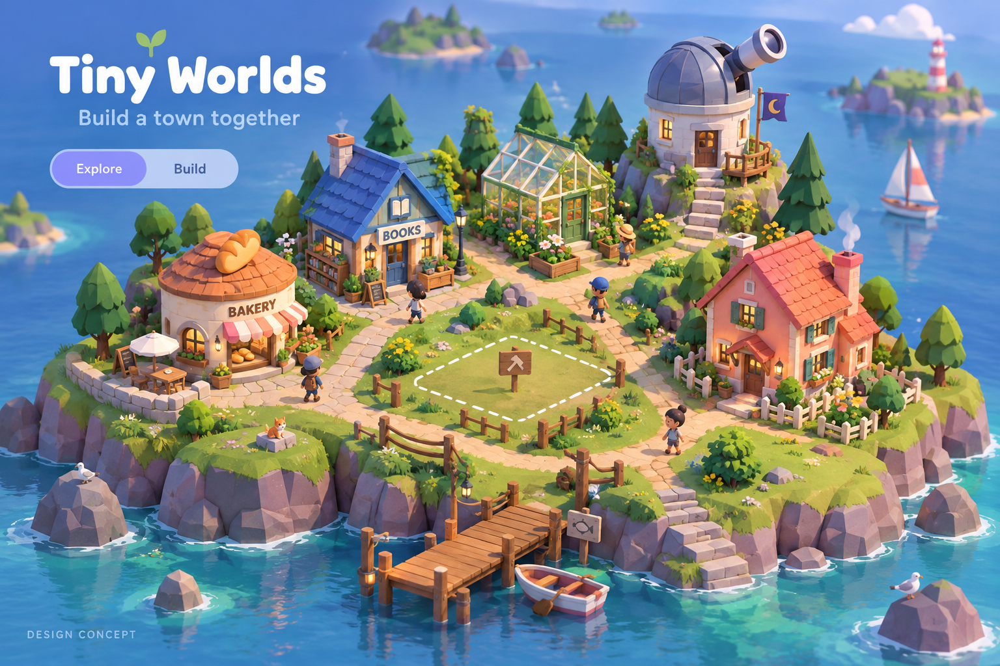
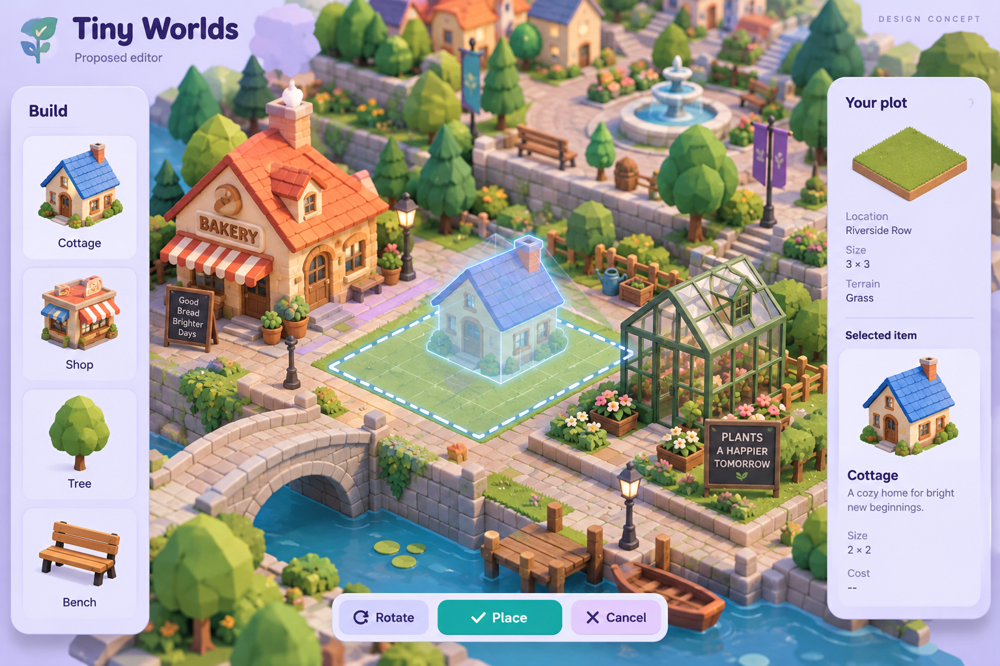
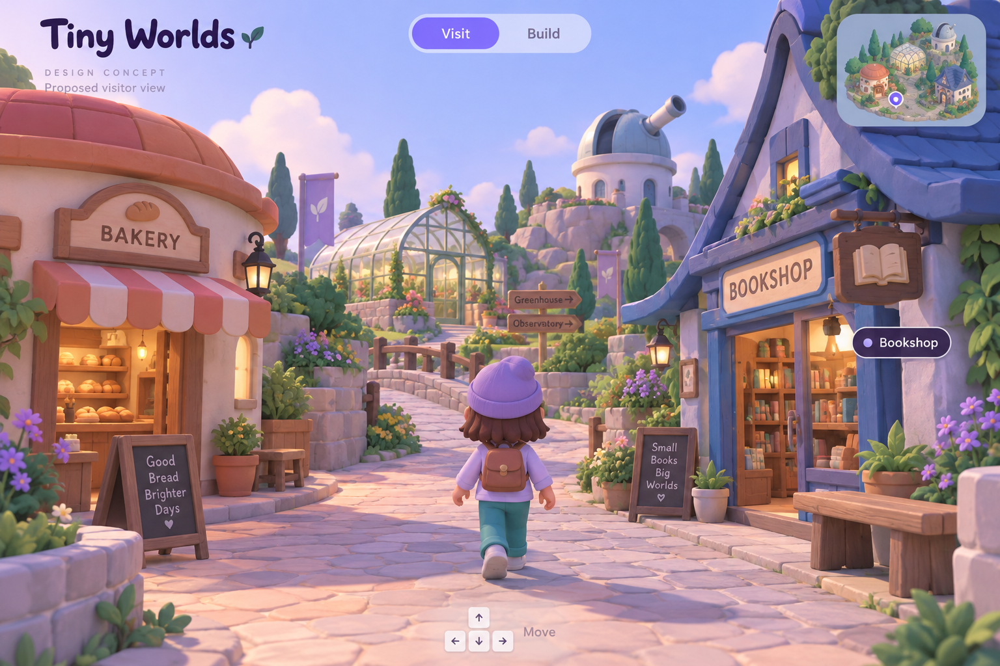

# Tiny Worlds

Build a shared 3D town online where friends contribute buildings, objects and characters, and visitors can walk around.

> Planning-stage project. The artwork below consists of AI-generated design concepts with synthetic content; it is not a screenshot of working software or a commitment to every pictured feature.

## First milestone

A small town with a few contributed buildings, a simple visitor mode and an editor that places and rotates a building on a plot.

## Starting work

- [ ] Define a modular building format and shared town layout.
- [ ] Create a few distinctive buildings and walkable paths.
- [ ] Build a basic plot editor with placement and rotation.
- [ ] Implement a visitor camera/avatar and plan persistence and collaborative updates.

Use GitHub Issues for actionable work and discussion, and pull requests for reviewable changes. Repository access and merge authority follow this repository's GitHub permissions. Joining a Karma42 project does not grant repository write access. No live agent execution is started by creating this repository.

## Design concepts

### Placing and rotating a building

### Visiting the town at street level

## Artwork and open choices

Generated with the built-in image generator. See [the prompts and provenance](assets/prompts.json). Generated examples, reference layers, names, counts and observations are illustrative. The owner has not yet selected a source-code or asset license; no license grant is added by this initial repository setup.

## Status

Project brief and artwork only. Runnable implementation, hosting and friend participation remain future work. Creating this repository does not resume the paused friends cloud experiment.

---

Initial project brief and artwork prepared with AI assistance for the Karma42 owner, 10 October 2026.
